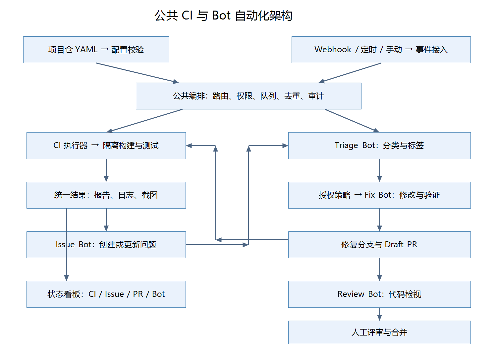

## 总体架构



公共仓统一维护 CI 模板、Bot 协议、公共执行器和配置 Schema。

| 组件            | 职责                                                         |
| --------------- | ------------------------------------------------------------ |
| 项目仓          | 项目配置、测试脚本、代码、Issue 和 PR                        |
| 公共平台仓      | 可复用 Workflow、YAML Schema、调度与执行实现、报告解析器、Bot 能力 |
| 事件服务        | 验签、归档、事件转换、可靠投递                               |
| 状态数据库      | 去重键、任务状态、锁、重试、Issue/PR 对应关系与审计          |
| CI/Agent 执行池 | 在隔离环境中运行脚本或修改代码                               |
| 凭据代理        | 按任务签发短期、最小权限凭据；模型密钥留在服务侧             |
| 产物存储        | 保存日志、报告、截图、录屏和修复补丁                         |
| 状态看板        | 展示 CI、Issue、PR 和 Bot 执行状态                           |

## 配置与执行方式

建议区分两类 YAML：

| 类型                 | 文件位置                   | 执行方式                |
| -------------------- | -------------------------- | ----------------------- |
| GitHub 原生 Workflow | `.github/workflows/*.yml`  | GitHub Actions 直接执行 |
| 平台业务 Workflow    | `.automation/workflow.yml` | 公共平台校验并解释执行  |

第一阶段先实现 GitHub 原生 CI 模板，同时开发平台 Bot 服务；第二阶段用统一业务 YAML 覆盖多代码平台和多执行环境。

**本文的业务 YAML 是待实现的配置协议，不是现成 GitHub Actions 语法。不能仅把文件提交到仓库，就获得自动修复与检视能力。**

GitHub 支持通过 `workflow_call` 定义公共工作流，并通过 Job 的 `uses` 调用。参考：[GitHub 可复用工作流](https://docs.github.com/en/actions/how-tos/reuse-automations/reuse-workflows)。

## 公共 CI 能力

### 配置范围

| 配置       | 说明                                         |
| ---------- | -------------------------------------------- |
| 触发条件   | PR、Push、定时、手动                         |
| 代码来源   | 平台、URL、分支或提交 SHA、目录              |
| 测试来源   | 产品仓内脚本或独立测试仓                     |
| 运行环境   | 操作系统、镜像、语言版本、CPU/内存、设备池   |
| 执行步骤   | 安装、构建、UT、集成测试、E2E                |
| 执行控制   | DAG 依赖、并行、超时、取消与有限重试         |
| 服务依赖   | 数据库、应用启动、健康检查                   |
| 凭据       | 引用凭据名称，不填写明文                     |
| 报告与产物 | JUnit、覆盖率、日志、截图、录屏              |
| 质量门禁   | 必需任务、零用例策略、报告缺失策略、覆盖率   |
| 输出       | Actions 状态、GitHub Checks、统一 JSON、看板 |

### 项目仓原生 Workflow 示例

文件：`.github/workflows/ci.yml`。以 Node.js 项目为例，命令须替换为项目真实脚本。

```yaml
name: Project CI

on:
  pull_request:
  push:
    branches: [main]
  workflow_dispatch:

permissions:
  contents: read

concurrency:
  group: ci-${{ github.workflow }}-${{ github.ref }}
  cancel-in-progress: true

jobs:
  ci:
    # 需先创建公共仓与工作流；正式接入固定为审核过的完整提交 SHA。
    uses: ScienceDiscovery/automation-platform/.github/workflows/node-ci.yml@v1
    with:
      repository: ${{ github.repository }}
      ref: ${{ github.sha }}
      runner: ubuntu-latest
      node_version: "22"
      working_directory: "."
      install_command: npm ci
      build_command: npm run build
      test_command: npm run test:ci
      report_paths: |
        reports/**
        coverage/**
        test-results/**
        playwright-report/**
      timeout_minutes: 30
      artifact_retention_days: 14
```

`repository` 使用 `owner/repository` 格式。PR 默认测试 GitHub 事件对应的合并提交，而不是必然测试 PR head；统一结果需分别记录 head SHA 和实际 tested SHA。跨仓读取私有代码需要额外授权。

### 公共仓可复用 Workflow 示例

文件：`.github/workflows/node-ci.yml`。

```yaml
name: Reusable Node CI

on:
  workflow_call:
    inputs:
      repository:
        type: string
        required: true
      ref:
        type: string
        required: true
      runner:
        type: string
        default: ubuntu-latest
      node_version:
        type: string
        default: "22"
      working_directory:
        type: string
        default: "."
      install_command:
        type: string
        default: npm ci
      build_command:
        type: string
        default: npm run build
      test_command:
        type: string
        required: true
      report_paths:
        type: string
        default: |
          reports/**
          coverage/**
          test-results/**
      timeout_minutes:
        type: number
        default: 30
      artifact_retention_days:
        type: number
        default: 14

permissions:
  contents: read

jobs:
  execute:
    runs-on: ${{ inputs.runner }}
    timeout-minutes: ${{ inputs.timeout_minutes }}
    defaults:
      run:
        shell: bash
        working-directory: ${{ inputs.working_directory }}
    steps:
      - name: Checkout source
        uses: actions/checkout@v4
        with:
          repository: ${{ inputs.repository }}
          ref: ${{ inputs.ref }}
          persist-credentials: false

      - name: Prepare Node
        uses: actions/setup-node@v4
        with:
          node-version: ${{ inputs.node_version }}

      - name: Install dependencies
        env:
          CI_COMMAND: ${{ inputs.install_command }}
        run: bash -e -o pipefail -c "$CI_COMMAND"

      - name: Build
        if: ${{ inputs.build_command != '' }}
        env:
          CI_COMMAND: ${{ inputs.build_command }}
        run: bash -e -o pipefail -c "$CI_COMMAND"

      - name: Run tests
        env:
          CI_COMMAND: ${{ inputs.test_command }}
        run: bash -e -o pipefail -c "$CI_COMMAND"

      - name: Upload reports
        if: ${{ always() }}
        uses: actions/upload-artifact@v4
        with:
          name: ci-reports-${{ github.run_id }}-${{ github.run_attempt }}
          path: ${{ inputs.report_paths }}
          if-no-files-found: warn
          retention-days: ${{ inputs.artifact_retention_days }}
```

约定与限制：

- 命令相对于 `working_directory` 执行，产物路径相对于工作区根目录。
- 测试脚本通过非零退出码表示失败；失败后仍尝试上传报告，机器故障或强制取消时不能保证上传。
- 此模板只上传产物，尚未解析 JUnit、计算覆盖率或生成统一结果；这些由后续公共报告模块完成。
- 示例 Action 标签正式推广时固定为经过审核的完整 SHA；运行池需由平台白名单约束。
- 项目配置、命令及被测代码均属于执行输入。不能因为通过环境变量传递命令，就认为任意命令具备安全性。

## 代码仓目录结构

Pyrhon项目目录结构如下。

```shell
DigitalMate/
├── digitalmate/                         # 核心Python源码文件
│   ├── component_xxx                    # 组件xxx（基础公共组件、功能组件）
│
├── recipes/                             # 可直接运行的实验配方
│
├── examples/                            # 此目录存放的东西xxx
│
├── tests/                               # 尽量镜像 digitalmate/
│   ├── component_xxx                    # tests/{component}/，与vllm_omni/{component}/保持镜像关系
│   ├── e2e/                             # 端到端功能用例
│   ├── dfx/                             # dfx用例：性能、可靠性、稳定性用例
|       ├── perf
|       ├── reliability
|       ├── stability
│
├── docs/                                # 项目文档源文件，由MkDocs构建
│   ├── getting_started/
│   ├── architecture/
│   ├── design/
│   ├── user_guide/
│   ├── developer_guide/
│   ├── api/
│
├── scripts/                             # 存放标准化项目脚本：不同系统包构建脚本
│   ├── build_pkg_harmonyos.sh
│   ├── build_pkg_ios.sh
│   ├── build_pkg_androids.sh
│   ├── build_pkg_windows.sh
│   ├── build_pkg_macos.sh
│
├── tools/                               # 开发、维护、测试工具集合。该目录通常服务于开发者、维护者和 CI。       
│   ├── xxx
│
├── requirements/                        # 不同系统的依赖
│   ├── harmonyos/
│   ├── ios/
│   ├── android/
│   ├── windows/
│   ├── macos/
|
├── .buildkite/                          # Buildkite持续集成配置CI
|
├── .github/                             # GitHub 仓库自动化和协作配置
|
├── .agents/                             # 面向代码Agent的技能说明，主要内容位于.agents/skills/
|
├── .claude/                             # 为Claude类代码Agent提供项目级技能和工作流程说明
|
├── .codex/                              # 为Codex类代码Agent提供项目级技能和工作流程说明
|
├── .editorconfig
├── .gitignore                           # 指定不应提交到Git的文件
├── .pre-commit-config.yaml              # 提交前自动检查配置
├── .markdownlint.yaml                   # Markdown格式规范。用于文档检查及Pre-commit使用
├── AGENTS.md                            # AI Agent编码项目工作说明书：告诉Agent如何理解项目、开发环境搭建、用例执行、编码风格、文件修改边界等
├── CONTRIBUTING.md                      # 贡献指南：如何参与贡献、开发文档入口、Issue和PR基本要求
├── LICENSE                              # 项目许可证
├── README.md                            # 项目首页和总览文档：项目定位、核心能力、架构、安装和快速开始链接、文档、社区和论文入口、许可证信息
└── pyproject.toml                       # Python 项目的核心元数据和开发工具配置文件
```

## CICD

### 静态检查

可在本地IDE运行，在门禁时自动运行。

| 检查范围        | 推荐工具           |
| --------------- | ------------------ |
| Python 代码质量 | Ruff Check         |
| Python 代码格式 | Ruff Format        |
| Python 类型检查 | mypy               |
| 通用文件格式    | `pre-commit-hooks` |
| 拼写            | Typos              |
| Markdown        | Markdownlint CLI2  |
| Shell 脚本      | ShellCheck         |
| GitHub Actions  | Actionlint         |
| 统一执行入口    | Pre-commit         |

.pre-commit-config.yaml

```yaml
repos:
  - repo: https://github.com/pre-commit/pre-commit-hooks
    rev: v6.0.0
    hooks:
      - id: check-yaml
      - id: check-json
      - id: check-toml
      - id: debug-statements
      - id: end-of-file-fixer
      - id: mixed-line-ending
        args: ["--fix=lf"]
      - id: trailing-whitespace
        args: ["--markdown-linebreak-ext=md"]

  - repo: https://github.com/astral-sh/ruff-pre-commit
    rev: v0.14.10
    hooks:
      - id: ruff-check
        args: ["--fix"]
      - id: ruff-format

  - repo: https://github.com/pre-commit/mirrors-mypy
    rev: v1.11.1
    hooks:
      - id: mypy
        additional_dependencies:
          - types-PyYAML
          - types-requests

  - repo: https://github.com/crate-ci/typos
    rev: v1.49.0
    hooks:
      - id: typos

  - repo: https://github.com/rhysd/actionlint
    rev: v1.7.7
    hooks:
      - id: actionlint
        files: ^\.github/workflows/.*\.ya?ml$

  - repo: https://github.com/DavidAnson/markdownlint-cli2
    rev: v0.23.2
    hooks:
      - id: markdownlint-cli2
        args: ["--fix"]
        files: \.md$

  - repo: local
    hooks:
      - id: shellcheck
        name: ShellCheck
        entry: shellcheck
        language: system
        types: [shell]
```

pyproject.toml

```toml
[tool.ruff]
line-length = 120
target-version = "py310"

[tool.ruff.lint]
select = [
    "E",   # pycodestyle错误
    "W",   # pycodestyle警告
    "F",   # Pyflakes
    "I",   # Import排序
    "N",   # 命名规范
    "UP",  # Python语法升级
]
ignore = ["E203"]

[tool.mypy]
python_version = "3.10"
ignore_missing_imports = true
check_untyped_defs = true
warn_unused_ignores = true
warn_redundant_casts = true

[tool.typos.default]
extend-ignore-identifiers-re = [
    "项目专用缩写",
]

[tool.pytest.ini_options]
testpaths = ["tests"]
```


### Bot

配置

#### Issue打标签和Issue描述完善Bot

标签分类

issue完善模板

#### Issue修改和PR提交Bot

#### PR检视Bot

#### CI Daily Bot

#### 版本Release Bot


### 用例分层

| 阶段   | 阶段名称              | 执行时间点/触发条件                                          | 用例覆盖重点                                                 | 执行环境                                                     | 测试目录                                                     | 建议时长         | 评率                                | 失败处理                                                     |
| ------ | --------------------- | ------------------------------------------------------------ | ------------------------------------------------------------ | ------------------------------------------------------------ | ------------------------------------------------------------ | ---------------- | ----------------------------------- | ------------------------------------------------------------ |
| **L1** | commit和PR提交        | 本地 Commit 前执行快速检查；PR 创建、更新或重新打开时执行完整基础检查 | 静态扫描&UT。代码规范、类型安全、敏感信息、可编译性、接口功能检查 | 本地环境及github提供云侧CPU Runner；deveco环境，需要一台PC进行运行，但不需要访问云侧workSwarm | tests/{component}/…，与 DigitalMate/{component}/ 保持镜像关系 | <5min            | 每次PR提交                          | CI失败则PR标红，不允许进入Ready                              |
| **L2** | PR Ready防线          | PR 从 Draft 转为 Ready，或添加 `ready-for-review` 标签时触发 | 静态扫描、UT&基础E2E。关键业务链路、基础E2E、模拟器交互      | HarmonyOS模拟器的windows/mac机器，需要对接云侧workSwarm测试环境，自动化替代人工进行UI交互 | tests/e2e/feature/...<br />tests/e2e/basic/...               | <15min           | 带有Ready标签的PR（同时运行L1）     | 阻止批准和合入；必须修复或明确豁免                           |
| **L3** | PR合入防线            | 合入`main`后继续执行真实资源深度验证                         | 关键E2E功能、性能。关键集成、真实服务、真实模型、真机Smoke、质量和性能Smoke | CI Runner；安装HarmonyOS模拟器的windows/mac机器，需要对接云侧workSwarm测试环境，自动化替代人工进行UI交互 | tests/e2e/feature_expand/...                                 | <30min           | PR 合并后（同时运行 L1 与 L2 测试） | 合入后失败则主分支标红、暂停Release；严重问题Revert或关闭功能 |
| **L4** | Nightly全量防线       | 每日低峰定时执行；重大架构修改后可手动触发                   | E2E。全功能、Agent质量、性能                                 | HarmonyOS真机，需要对接云侧workSwarm测试环境自动化替代人工进行UI交互 | tests/dfx/perf/...                                           | <3小时           | 每日夜间运行                        | 生成报警和趋势报告；阻止产生Release Candidate                |
| **L5** | Release Candidate防线 | 创建Release Tag、RC分支或准备应用市场发布时触发              | E2E。最终发布产物、安装升级、签名，全功能、Agent质量、性能、稳定性、可靠性、异常恢复和兼容性 | 最终签名环境、Release配置、真机矩阵、预发布后端              | tests/dfx/stabity/...<br />tests/dfx/reliabity/...           | 根据实际情况而定 | 版本发布前数日运行                  | 阻止发布；P0/P1、安全、升级和签名问题不得豁免                |


## 看板

### CICD看板

1、总览：各层用例执行成功率、耗时、执行结果统计

2、门禁PR：ready状态PR、合入状态PR的通过率

3、daily：每日用例验证结果，包含用例链接、用例通过率、失败用例展示

4、Release：不同类型用例（功能、稳定性、可靠性、性能等）看板，包含用例链接、用例通过率、失败用例展示

4、性能专项用例：性能用例执行情况和性能变化趋势，如果性能不符合预期，展示文字告警

5、UT覆盖率：UT总覆盖率值、不同目录UT覆盖率值和不同时间点曲线


### 项目生态健康度看板

1、社区生态概览：star数量和增长曲线、fork数和增长曲线、内部/外部贡献者数量和增长曲线、PR数量和增长曲线、issue数量和增长曲线

2、issue：open、closed数量，issue解决周期等

3、PR：不同时长（当日、一周、一个月）不同状态（open、merged等）数量展示，不同时长可选择，默认一周


## 参考链接

看板参考

https://hsliuustc0106.github.io/vllm-omni-kanban/

https://nanzhaogang.github.io/community-ecosystem/#/contributors


用例分级参考

https://github.com/vllm-project/vllm-omni/blob/main/docs/contributing/ci/test_system_overview.md

https://github.com/openJiuwen-ai/sciencediscovery/pull/259


